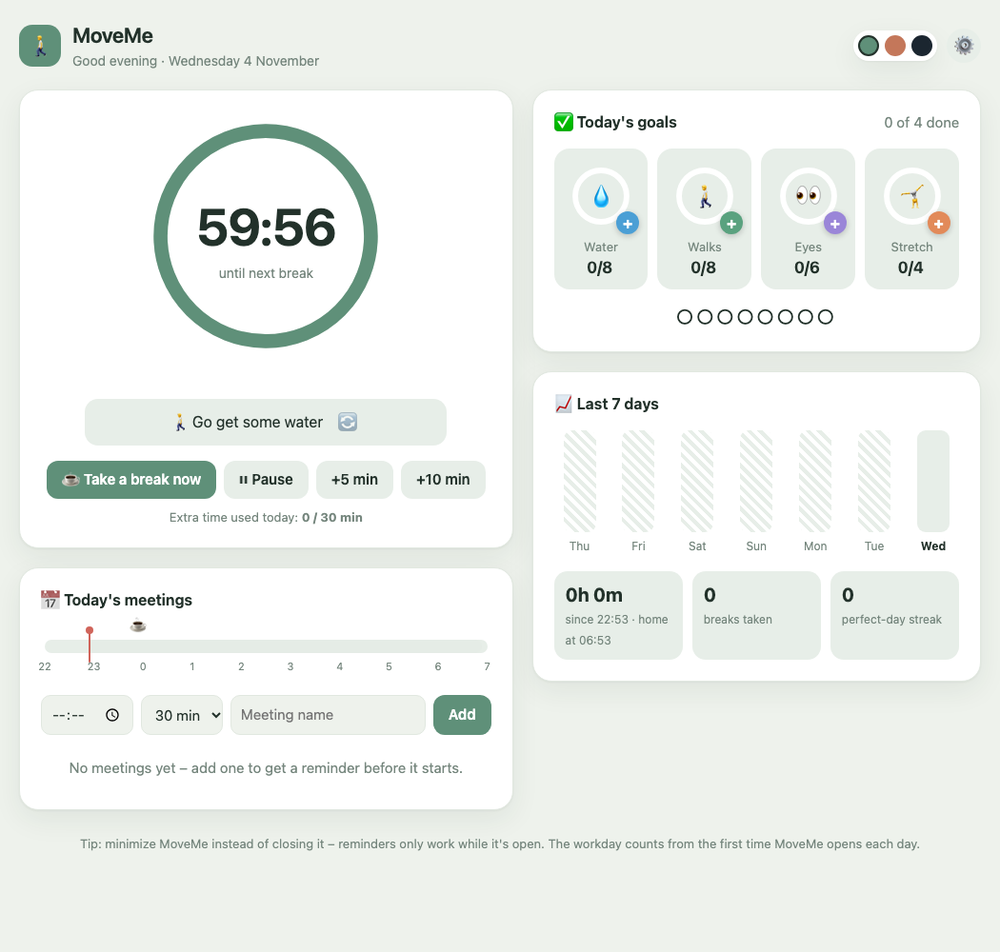
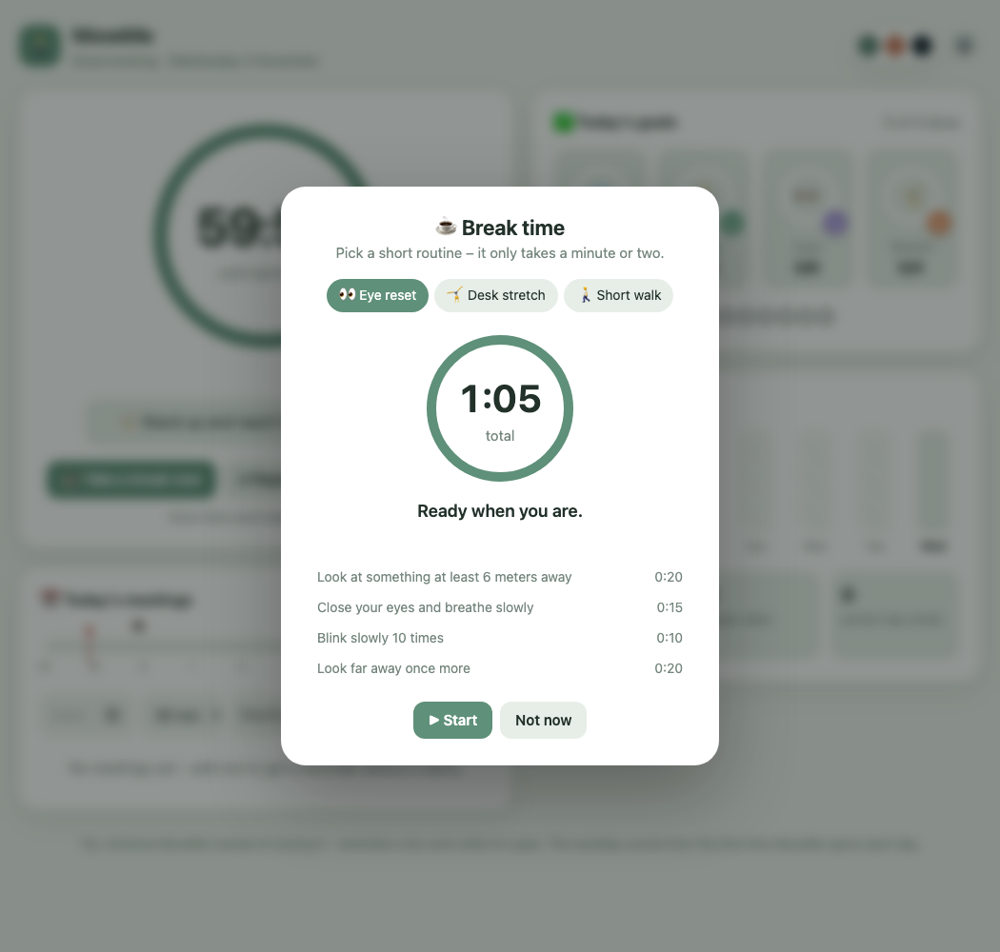
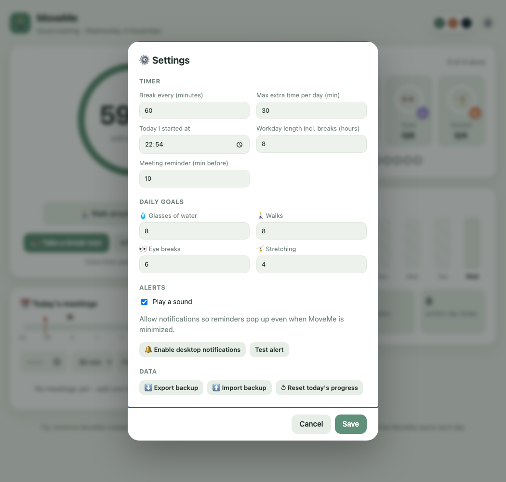

# 🚶 MoveMe

A personal coach for breaks while working at a computer: a break timer with short
exercises, meeting reminders, hydration tracking and daily goals.

**Web app:** https://lucia-ship-it.github.io/MoveMe/

All data (goals, meetings, settings) is stored locally on your computer only.
Nothing is sent to GitHub or anywhere else.

## What's inside

**Dashboard** – break countdown, daily goals (water, walks, eye breaks, stretching),
today's meetings and a 7-day overview.



**Break routines** – pick an eye reset, desk stretch or short walk and follow it step by step.



**Settings** – break interval, workday length, meeting reminder lead time, daily goals,
sound and notifications, plus backup export/import.



Three colour themes (sage, sand, night) can be switched in the top-right corner.

---

## Desktop app (Windows and macOS)

Download the installer from the [Releases page](https://github.com/Lucia-ship-it/MoveMe/releases):

- Windows: `MoveMe-<version>-win-x64.exe`
- macOS: `MoveMe-<version>-mac-arm64.dmg` (Apple Silicon) or `-mac-x64.dmg` (Intel)

The apps are not signed or notarized by Apple (that needs a paid developer account), so:

- **Windows:** SmartScreen shows a warning – click *More info → Run anyway*.
- **macOS:** do **not** drag MoveMe out of the DMG with Finder. macOS marks the copy as
  "downloaded from the internet" and the app then just bounces in the Dock and never opens.
  Install it from Terminal instead (works on Apple Silicon and Intel):

  1. Double-click the `.dmg` to mount it.
  2. Run:
     ```
     ditto --noqtn /Volumes/MoveMe/MoveMe.app /Applications/MoveMe.app
     ```
     (If `/Applications/MoveMe.app` already exists from an earlier attempt, delete it first.)
  3. Open MoveMe from Launchpad or Applications.

  If the mounted disk has a different name, check it with `ls /Volumes`.

Allow notifications when asked, so reminders show up even when the window is minimized.
You can check this in ⚙️ Settings → *Test alert*.

> Tip: minimize MoveMe instead of closing it – reminders only work while the app is running.

**Releasing a new version:** `git tag v1.0.1 && git push origin v1.0.1`.
GitHub Actions builds both installers and attaches them to the release.
To run it locally: `npm install && npm start`.

---

## Use it as a web app

### 1. Enable GitHub Pages (once)

1. On GitHub open the **MoveMe** repository → **Settings** → **Pages**.
2. *Source*: **Deploy from a branch**, *Branch*: **main** and **/ (root)** → **Save**.
3. After 1–2 minutes the app is live at the address above.

### 2. Install on a work computer (Windows, Edge)

1. Open https://lucia-ship-it.github.io/MoveMe/ in Edge.
2. Click **⋯ → Apps → Install MoveMe** (or the install icon in the address bar).
3. MoveMe opens in its own window and appears in the Start menu.
   Right-click its taskbar icon to **pin it**.
4. Allow **notifications** on first use. You can verify in ⚙️ Settings → *Test alert*.

### 3. Start automatically at login

1. In Edge open `edge://apps`.
2. Next to MoveMe click **⋯ → App details**.
3. Turn on **Auto-start on device login**.

### Updates

When `MoveMe.html` changes on GitHub, the new version loads the next time you open the app.
The app also works offline (it uses the last saved version).

---

## Fallback: run from a file (no internet, no GitHub Pages)

If your company blocks `github.io`:

1. Download `MoveMe.html` and `Spustit-MoveMe.bat` into one folder
   (on GitHub **Code → Download ZIP**, or clone in VS Code).
2. Double-click `Spustit-MoveMe.bat` to open MoveMe in its own window.
3. To autostart: **Win + R** → `shell:startup` → put a **shortcut** to `Spustit-MoveMe.bat` there.

If `.bat` files are blocked, create a desktop shortcut with this target:

```
"C:\Program Files (x86)\Microsoft\Edge\Application\msedge.exe" --app="file:///C:/Users/YOUR_NAME/Documents/MoveMe/MoveMe.html"
```

In this mode Windows system notifications are less reliable –
reminders are signalled by sound and a flashing taskbar icon.

## Files

| File | Purpose |
|---|---|
| `MoveMe.html` | the whole app |
| `index.html` | redirects the main address to the app |
| `manifest.webmanifest`, `icon*` | name and icon of the installed app |
| `sw.js` | offline support and notifications |
| `main.js`, `package.json` | desktop app (Electron) |
| `.github/workflows/release.yml` | builds Windows and macOS installers |
| `Spustit-MoveMe.bat` | launch from a file on Windows |
| `MoveMe-simple.html` | older, simpler version |
| `docs/` | README screenshots |
